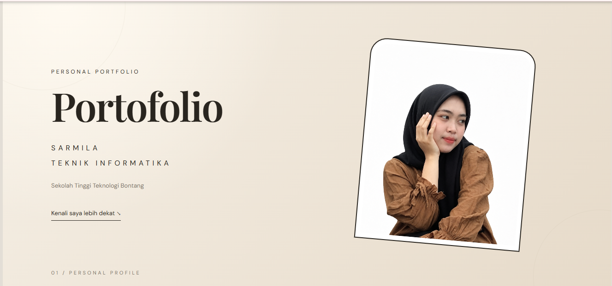
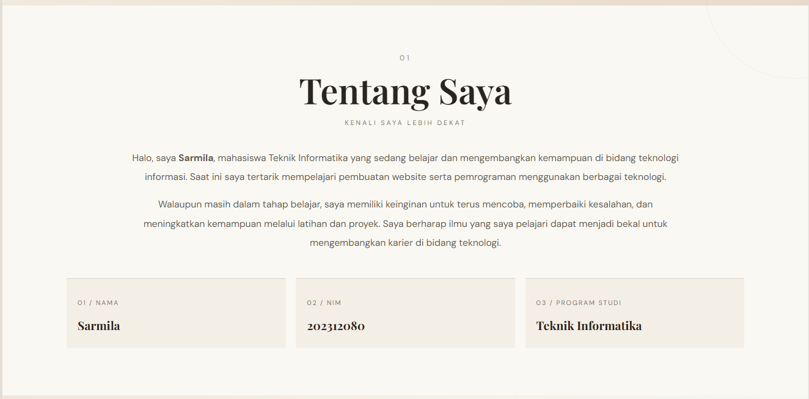
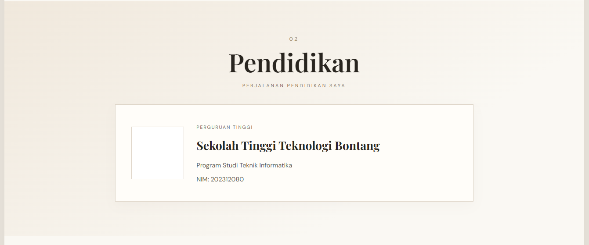
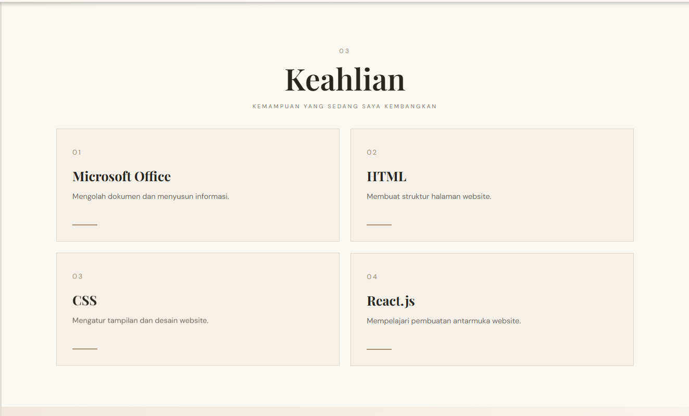
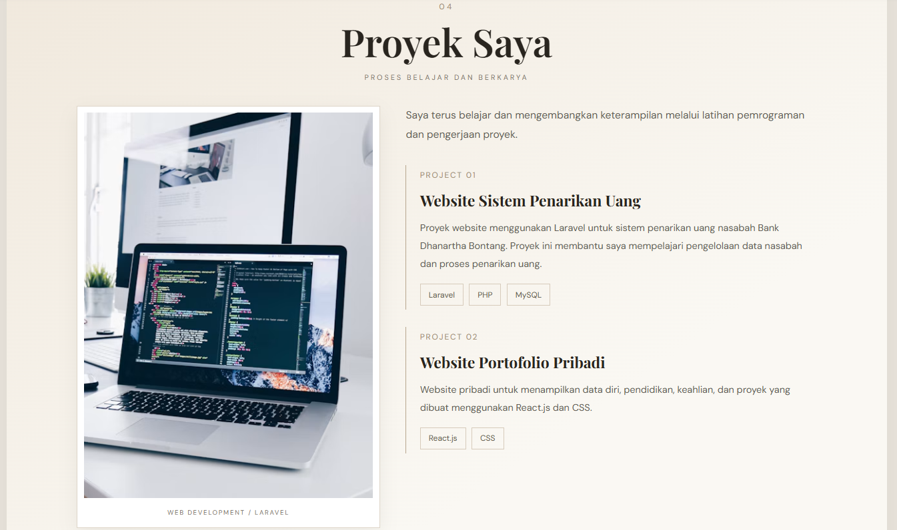
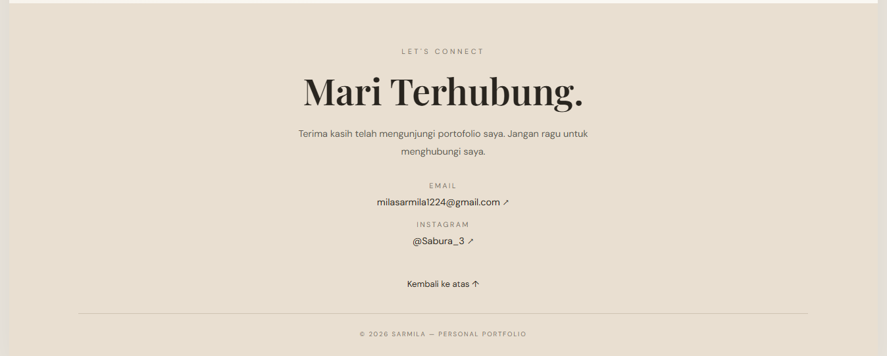

# PERSONAL WEBSITE PORTOFOLIO SARMILA

## 1. Deskripsi Proyek

Personal Website Portofolio Sarmila merupakan website pribadi yang dibuat untuk memperkenalkan identitas, latar belakang pendidikan, keterampilan, dan proyek yang pernah dikerjakan.

---

## 2. Identitas Mahasiswa

| Keterangan | Informasi |
|---|---|
| Nama | Sarmila |
| NIM | 202312080 |
| Perguruan Tinggi | Sekolah Tinggi Teknologi Bontang |
| Program Studi | Teknik Informatika |
| Mata Kuliah | Pemrograman Berbasis Framework |
| Jenis Tugas | Ujian Tengah Semester (UTS) |
| Judul Proyek | Personal Website Portofolio |

---

## 3. Teknologi yang Digunakan

Berikut teknologi yang digunakan dalam pembuatan website:

1. **React JS** – Digunakan untuk membangun tampilan website berbasis komponen.
2. **HTML** – Digunakan untuk menyusun struktur halaman website.
3. **CSS** – Digunakan untuk mengatur desain, warna, ukuran, dan tata letak.
4. **JavaScript** – Digunakan untuk membuat fungsi dan interaksi website.
5. **Vite** – Digunakan sebagai perangkat pengembangan dan menjalankan aplikasi React.
6. **Visual Studio Code** – Digunakan sebagai aplikasi untuk menulis dan mengelola kode program.

---

## 4. Fitur Website

Website portofolio ini memiliki beberapa fitur utama sebagai berikut.

### 4.1 Profil

Menampilkan identitas diri dan foto profil Sarmila.



### 4.2 TentangSaya
Menampilkan informasi singkat mengenai diri, latar belakang, dan deskripsi pribadi.



### 4.3 Pendidikan

Menampilkan informasi riwayat pendidikan dan perguruan tinggi.



### 4.4 Keahlian

Menampilkan keterampilan yang dimiliki, antara lain:

- Microsoft Office
- HTML
- CSS
- React JS



### 4.5 Project

Menampilkan proyek yang pernah dikerjakan, salah satunya adalah Sistem Penarikan Uang Nasabah menggunakan Laravel.



### 4.6 Kontak

Menampilkan informasi kontak yang dapat digunakan untuk menghubungi pemilik website.

- Email: milasarmila1224@gmail.com
- Instagram: Sabura_3



---

## 5. Struktur Folder Proyek

Berikut struktur folder utama proyek Personal Website Portofolio Sarmila.

```text
FORTOFOLIO/
│
├── public/
│   ├── images/
│   │   ├── foto-saya.png
│   │   ├── logo kampus.jpg
│   │   ├── profil.png
│   │   ├── tentangsaya.png
│   │   ├── pendidikan.png
│   │   ├── keahlian.png
│   │   ├── project.png
│   │   └── contact.png
│   │
│   └── favicon.svg
│
├── src/
│   ├── App.jsx
│   ├── App.css
│   ├── index.css
│   └── main.jsx
│
├── index.html
├── package.json
├── package-lock.json
├── vite.config.js
├── .gitignore
└── README.md
```

---

## 6. Cara Instalasi dan Menjalankan Website

Berikut langkah-langkah untuk menjalankan website di komputer.

### 6.1 Persiapan

Pastikan perangkat sudah memiliki aplikasi berikut:

- Node.js
- npm
- Visual Studio Code

### 6.2 Membuka Folder Proyek

Buka Visual Studio Code, kemudian pilih folder proyek Personal Website Portofolio Sarmila.

### 6.3 Membuka Terminal

Pilih menu Terminal, kemudian New Terminal.

### 6.4 Menginstal Dependencies

Jalankan perintah berikut:

```bash
npm install
```

Tunggu hingga proses instalasi selesai.

### 6.5 Menjalankan Website

Setelah instalasi selesai, jalankan perintah:

```bash
npm run dev
```

### 6.6 Membuka Website

Setelah server berjalan, buka alamat yang ditampilkan di terminal, biasanya:

```text
http://localhost:5173/
```

Website akan tampil melalui browser.

---

## 7. Link Repository GitHub

Source code proyek dapat diakses melalui repository GitHub berikut:

[Personal Website Portofolio Sarmila](https://github.com/milamil12112-dot/fortofolio-sarmila)

---

## 8. Dokumentasi Website

Dokumentasi gambar pada bagian fitur website digunakan untuk memperlihatkan tampilan dan bagian-bagian utama dari Personal Website Portofolio Sarmila.

Gambar dokumentasi disimpan di dalam folder `public/images` agar tersusun rapi dan mudah dikelola.

---

## 9. Penutup

Pembuatan Personal Website Portofolio Sarmila merupakan salah satu bentuk penerapan ilmu yang telah dipelajari dalam mata kuliah Pemrograman Berbasis Framework.

Melalui proyek ini, mahasiswa dapat memahami proses pembuatan website menggunakan React JS, mulai dari penyusunan komponen, pengaturan tampilan, pengelolaan gambar, hingga publikasi source code melalui GitHub.

Website ini diharapkan dapat menjadi media untuk memperkenalkan identitas, keterampilan, riwayat pendidikan, dan hasil proyek yang telah dikerjakan.
S
